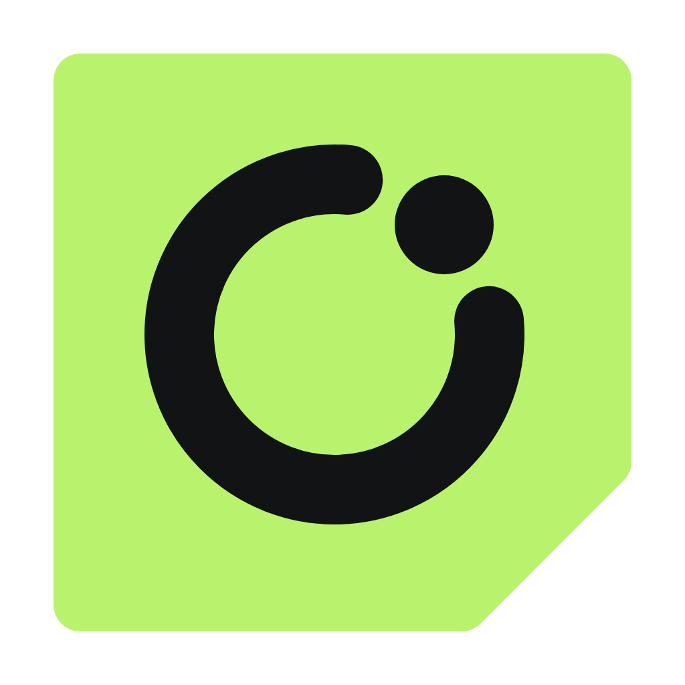
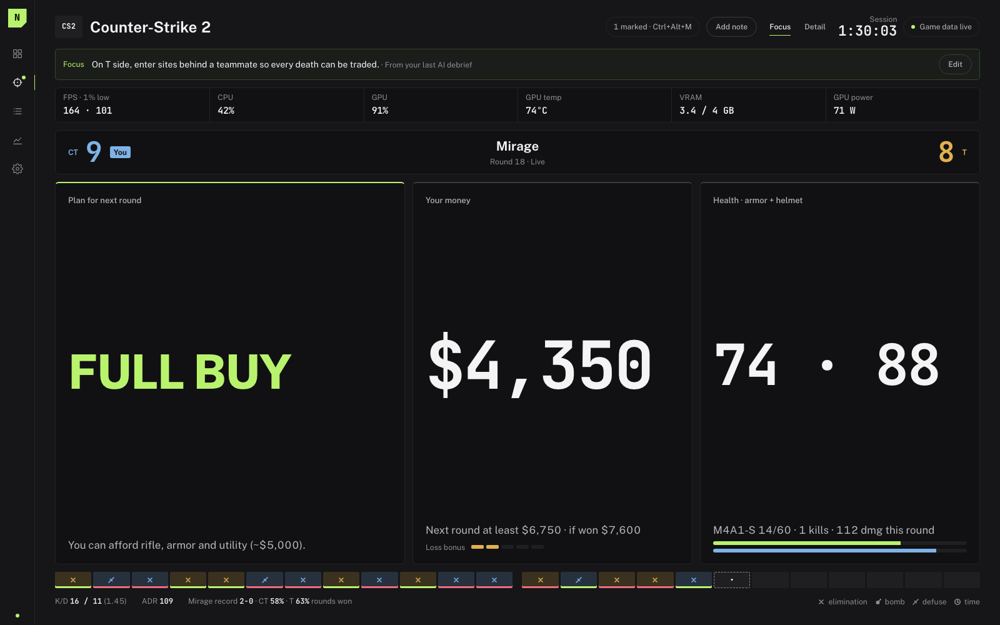
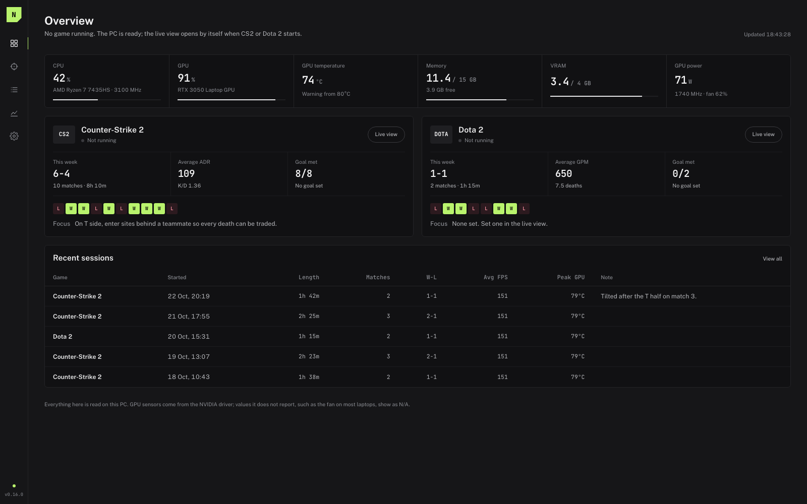
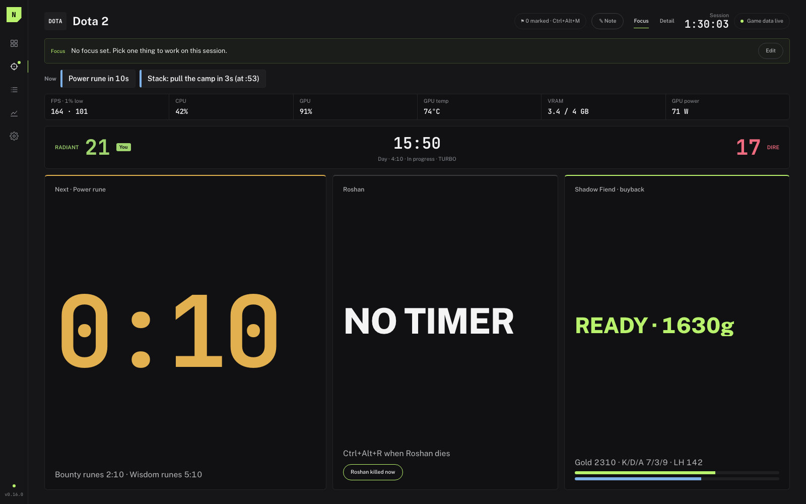
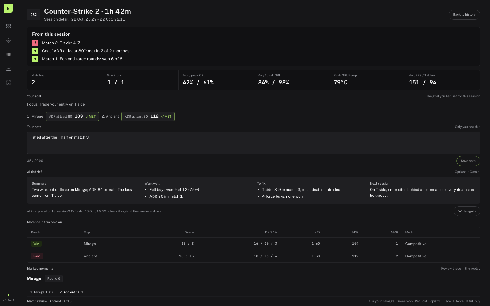
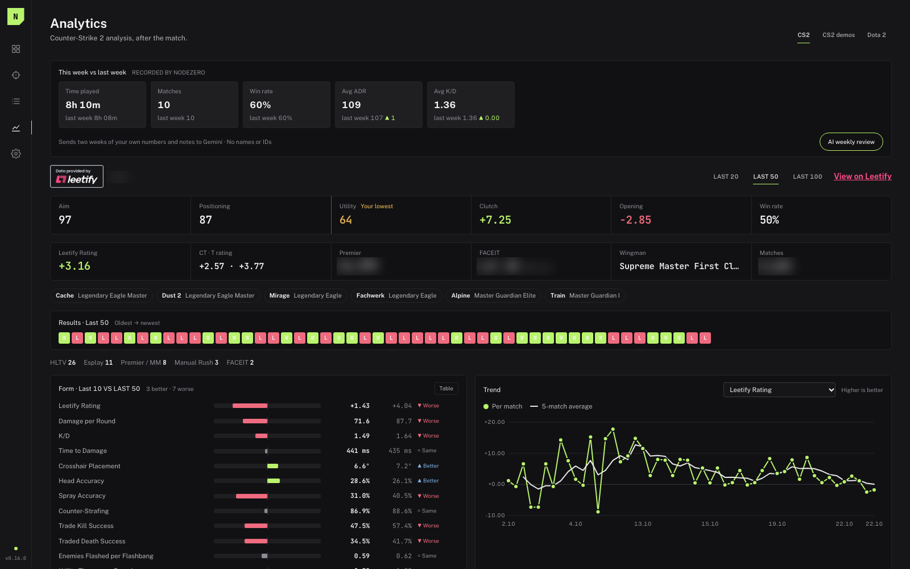

# NODEZERO

**A free second-monitor coach for Counter-Strike 2 and Dota 2.**

Your live match, your PC, and your own history on one screen, built only from data the game and your own accounts already give you. No cheats, no overlays, nothing injected.

### [⬇ Download for Windows](https://github.com/murathudavendigar/nodezero-releases/releases/latest)

Download <code>NODEZERO_x.y.z_x64-setup.exe</code> from the latest release. About 3 MB, installs without admin rights.

 

## What it does

**Counter-Strike 2**
- **Buy plan for the next round** from your money, the loss bonus, and the round result. It stays on screen after you die.
- Round history with how each round ended, your ADR, K/D, and map record.
- **Map pool and Premier veto:** what to pick and what to ban, from your own results.
- Stats from **Leetify** and **FACEIT**, a local match archive, and **CS2 demo analysis** after the match.

**Dota 2** (normal and Turbo, detected automatically)
- Rune, Roshan, Aegis, and Tormentor timers, with optional short beeps.
- Your GPM, XPM, and last hits next to other players of the same hero (OpenDota).
- Item timings, deaths, and gold lost in a match review, plus your hero pool.

**Both games**
- **Sessions:** every session is saved with its matches, hardware peaks, and your notes.
- **Patterns:** how you play by match of the session, after a loss, and by time of day, and who you win with. Friends in your Steam party are remembered per match, and you can add a friend by their Steam link.
- **Focus and goals:** set one thing to work on and see whether you hit it.
- **Optional AI debrief** (your own Gemini key): a short review after a session, never during a match.
- **Your PC:** CPU, GPU, VRAM, temperature, and game FPS with 1% lows.

| | |
| --- | --- |
|  |  |
|  |  |

## Fair play

NODEZERO uses **Valve's official Game State Integration (GSI)**, the same feature used by tournament broadcasts and RGB keyboards. The game writes your own state to a local address on your PC; NODEZERO only listens.

- It never reads game memory, injects anything, or draws over the game.
- It never shows information about the other team. GSI only sends a player their own data.
- The CS2 bomb timer is **off by default**, because FACEIT and some leagues do not allow second-screen bomb timers.

## Install

1. Download `NODEZERO_x.y.z_x64-setup.exe` from the [latest release](https://github.com/murathudavendigar/nodezero-releases/releases/latest) and run it.
2. Windows may say **"Windows protected your PC"**, because the installer is not code-signed (signing certificates are expensive for a free project). Press **More info → Run anyway**.
3. NODEZERO opens on **Get started**:
   - Press **Install**. It adds one small config file to your CS2 and Dota 2 folders (found through Steam).
   - For Dota 2, add `-gamestateintegration` to its launch options in Steam (right-click → Properties).
   - Restart the game. The live view opens by itself.

### Optional extras

Everything below is free and optional. Without it, that part of the app shows `N/A`. Setup has a link next to each one.

| Service | Adds | Where to get it |
| --- | --- | --- |
| Steam Web API key | Hours played, CS2 lifetime stats, which friends are in a game | [steamcommunity.com/dev/apikey](https://steamcommunity.com/dev/apikey) |
| Leetify | Aim, utility, and positioning ratings and your recent matches | Works without a key; optional key at [leetify.com/app/developer](https://leetify.com/app/developer) |
| FACEIT key | FACEIT level, Elo, and match history | [developers.faceit.com](https://developers.faceit.com) (server-side key) |
| Gemini key | AI debriefs and weekly reviews | [aistudio.google.com/apikey](https://aistudio.google.com/apikey) |
| OpenDota | Dota comparisons and match lists | On by default, no key |
| PresentMon | Game FPS and 1% lows | One button in Setup downloads Intel's signed build |

## Updates

NODEZERO checks this page for new versions. When one is out, a banner shows what changed with an **Install and restart** button. You can turn on automatic updates in Setup → Preferences. It never updates while CS2 or Dota 2 is running, and your sessions and settings are kept.

## Privacy

- Everything is stored on your PC in `%APPDATA%\com.murat.second-monitor-app`. There is no NODEZERO server, account, or analytics.
- Lookups go only to the services you turn on, and only for your own account.
- About → **Delete all data** removes it all. Uninstall from Windows Settings → Apps.

## FAQ

**Can I get banned for this?**
NODEZERO only uses Valve's official GSI, which Valve provides for exactly this kind of tool. It does not touch the game's memory or files beyond adding the one config file.

**Will it slow my game down?**
It runs at "below normal" priority, so Windows always schedules the game first. It measured about 0.16% of total CPU during a game.

**I have an AMD or Intel GPU.**
GPU load and VRAM are read from Windows. Temperature, clock, fan, and power are only available on NVIDIA and show `N/A` on other GPUs.

**FPS shows N/A.**
Setup → Game FPS: press **Download PresentMon**, then **Allow FPS measurement** (a one-time Windows prompt), then sign out of Windows and back in once.

**Does it work on macOS or Linux?**
No, Windows only.

## Feedback

Found a bug or have an idea? Use **About → Report a problem** in the app. It opens a [GitHub issue](https://github.com/murathudavendigar/nodezero-releases/issues) with your NODEZERO version, Windows, CPU, GPU, and setup state already filled in, and no keys, Steam ids, or names.

---

<b>Türkçe kurulum</b>

1. [Son sürümden](https://github.com/murathudavendigar/nodezero-releases/releases/latest) `NODEZERO_x.y.z_x64-setup.exe` dosyasını indirip çalıştır.
2. Windows "Bilgisayarınız korundu" derse **Ek bilgi → Yine de çalıştır**'a bas. Kurulum dosyası imzalı olmadığı için bu uyarı çıkar.
3. **Get started** adımlarını izle:
   - **Install**'a bas.
   - Dota 2 için Steam'de başlatma seçeneğine `-gamestateintegration` ekle.
   - Oyunu yeniden başlat.
4. Steam, Leetify, FACEIT ve Gemini anahtarları isteğe bağlıdır. Setup'ta her birinin yanında nereden alınacağını gösteren bir bağlantı var.

Güncelleme çıkınca uygulamanın üstünde bir banner görünür. Oyun açıkken güncelleme yapılmaz.

Made by Murat Hüdavendigâr Öncü · [GitHub](https://github.com/murathudavendigar). NODEZERO is not affiliated with Valve, Leetify, FACEIT, OpenDota, Google, or Intel. Counter-Strike 2 and Dota 2 are trademarks of Valve Corporation. PresentMon is Intel's open-source tool and is downloaded from Intel's own GitHub release.
