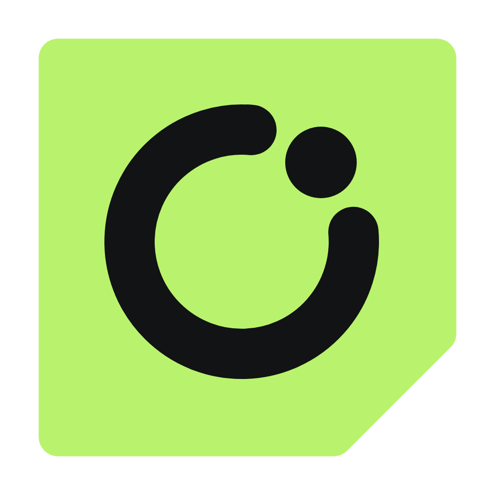
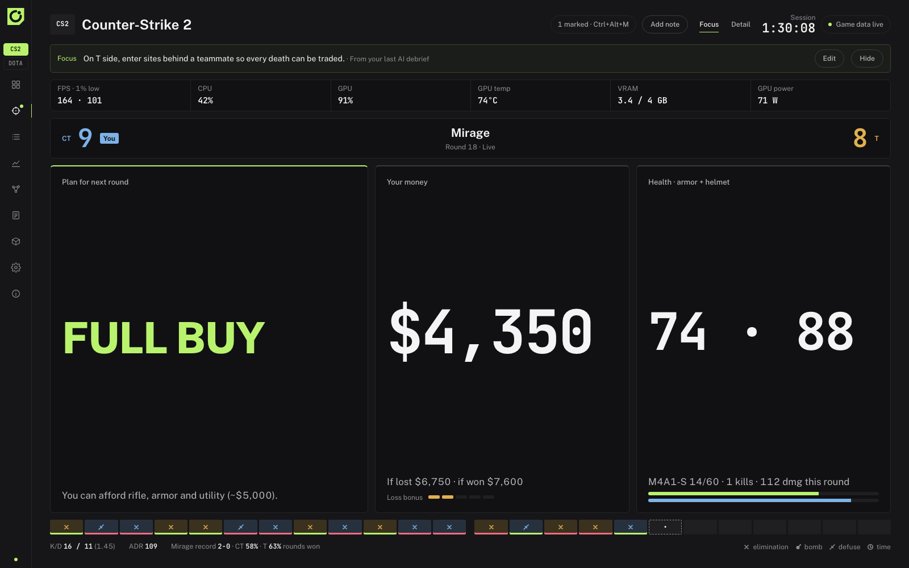
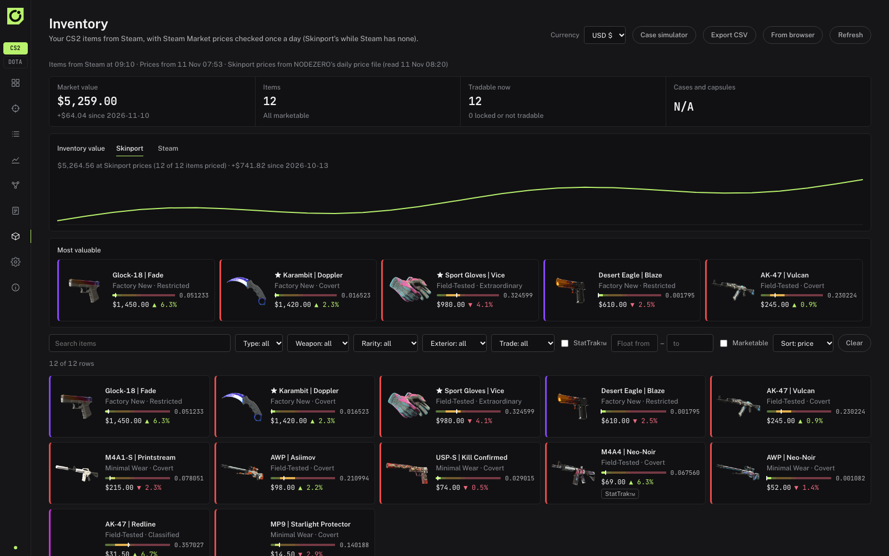
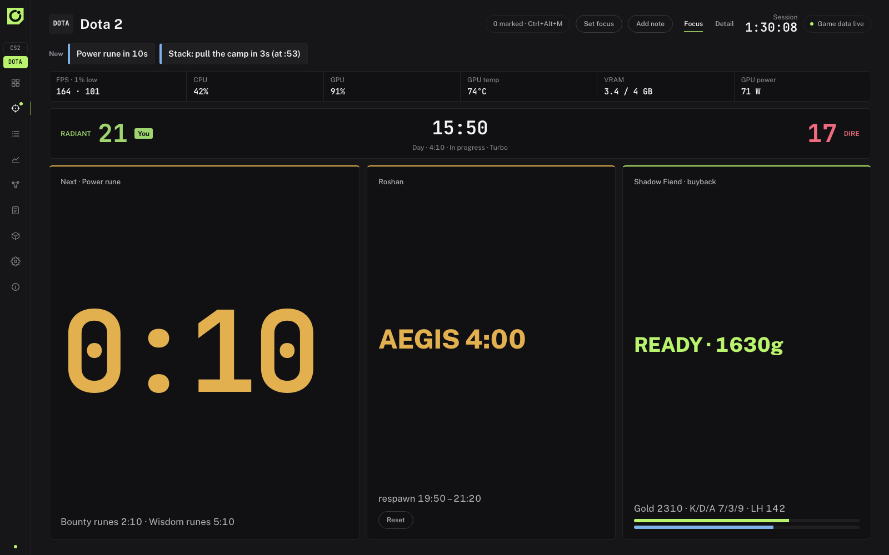
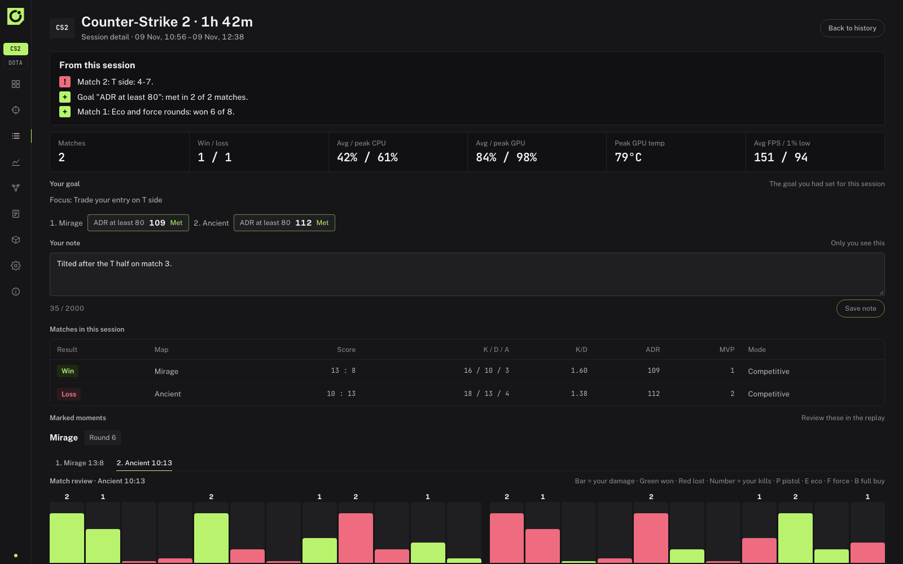
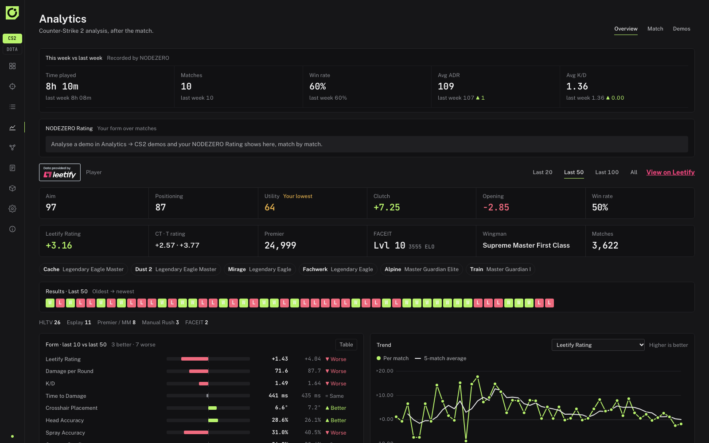

# NODEZERO

**A free second-monitor coach for Counter-Strike 2 and Dota 2.**

Your live match, your PC, and your own history on one screen, built only from data the game and your own accounts already give you. No cheats, no overlays, nothing injected.

### [⬇ Download for Windows](https://github.com/murathudavendigar/nodezero-releases/releases/latest)

Download <code>NODEZERO_x.y.z_x64-setup.exe</code> from the latest release. About 6 MB, installs without admin rights.

 

## Why I made it

I play a lot of CS2 (Premier and FACEIT) and Dota 2 Turbo, and I always had a second monitor doing nothing. My stats were spread over five websites and none of them told me what to do *next round*. So I built one app that puts the live match, my own history, and my PC on that second screen. It is a hobby project by one person, free, with no ads and no account.

## Highlights

- **CS2 buy plan for the next round**, from your money, the loss bonus, and the round result.
- **NODEZERO Rating (NZR):** a 1.0-10.0 score for every player in a CS2 match (6.0 is the lobby average), split into fragging, damage, survival, impact, and team play.
- **CS2 demo analysis:** where you died and where the killer stood, a 2D replay of every round, how you shoot, and a scoreboard of both teams. New demos are read by themselves after you close the game.
- **A notice after each CS2 match** with the map, result, your NZR, and your Premier change.
- **Dota 2 timers** for runes, Roshan, Aegis, and Tormentor, with Turbo times.
- **Your CS2 and Dota 2 inventory** with daily prices, float and pattern, and price alerts.

## Everything it does

**Profile** (the first page)
- Your Premier, FACEIT, Wingman, and Dota medal in one line, your Premier and NZR trend, your Dota form and heroes, your inventory worth, this week's record, and your PC.

**Counter-Strike 2**
- **Buy plan for the next round.** It stays on screen after you die.
- Round history with how each round ended, your ADR, K/D, and map record.
- **Map pool and Premier veto:** what to pick and what to ban, from your own results.
- Stats from **Leetify** and **FACEIT**, and a local match archive.
- **Demo analysis** after the match: deaths with no teammate near, deaths with a grenade still in hand, how you shoot (standing still on the first bullet, hits, head share), each round's buys, a utility map, a 2D replay with player cards and a round story, and a match card picture to share (no names or ids).
- A **scoreboard of both teams** for each match: NZR, Leetify Rating, HLTV Rating 1.0, an approximate Rating 2.0, ADR, KAST, each player's Premier rating and the points won or lost, and the context of each kill (clutches, outnumbered, against better gear, eco, post-plant). FACEIT matches are listed too.
- A match without a demo gets a **Download demo in CS2** button.

**Dota 2** (normal and Turbo, detected automatically)
- Rune, Roshan, Aegis, and Tormentor timers, with optional short beeps.
- Your GPM, XPM, and last hits next to other players of the same hero (OpenDota).
- Item timings, deaths, and gold lost in a match review, plus your hero pool.
- A **heat map** of where you played and died, on the game's own minimap.
- Optional **STRATZ** (your own free token): a scoreboard of all ten players, your lane against the enemy in your role, your side's win chance per minute, where and how you died, your wards, item timings against your own average, and the friends you queue with.

**Both games**
- **Sessions:** every session is saved with its matches, hardware peaks, and your notes.
- **Patterns:** how you play by match of the session, after a loss, and by time of day, and who you win with.
- **Inventory:** CS2 and Dota 2 items with Steam Market and Skinport prices (USD or EUR), checked once a day: total value and its change, every CS2 copy's **float and pattern**, Inspect in game, price alerts, the biggest movers, and a CSV export. Needs a public Steam inventory.
- **Case simulator** (just for fun, no real money): open any CS2 case with Valve's published odds and real prices.
- **Report:** your week or month against the one before, with one thing to work on and what is going well.
- **Focus and goals:** set one thing to work on and see whether you hit it.
- **Your PC:** CPU, GPU, VRAM, temperature, and game FPS with 1% lows.

| | |
| --- | --- |
|  |  |
|  |  |

## Fair play

NODEZERO uses **Valve's official Game State Integration (GSI)**, the same feature used by tournament broadcasts and RGB keyboards. The game writes your own state to a local address on your PC; NODEZERO only listens.

- It never reads game memory, injects anything, or draws over the game.
- It never shows information about the other team. GSI only sends a player their own data.
- The CS2 bomb timer is **off by default**, because FACEIT and some leagues do not allow second-screen bomb timers.

## Why trust it?

Fair question for an unknown .exe from the internet. Here is what you can check yourself:

- **Scan the file.** Every release is uploaded to VirusTotal by itself when it comes out, and its release page shows how many engines flagged it, with a link to the full report. The page also lists the installer's SHA-256, so you can check that your download is the same file (`Get-FileHash` in PowerShell).
- **No password, no Steam login.** NODEZERO never asks for your Steam password and never signs in to Steam. Keys for Steam, Leetify, FACEIT, and STRATZ are optional: the app works without any of them, and the ones you add stay on your PC.
- **It only talks to the services it lists.** About → Data sources names every outside service it uses and why. There is no NODEZERO server, account, or analytics.
- **It does not touch the game.** It only adds Valve's GSI config file to the game folders. Setup → Remove takes it out again.
- **Why no code-signing?** A Windows code-signing certificate costs a few hundred dollars a year, which is a lot for a free hobby project. That is why SmartScreen warns you.
- **Why is the code not public?** It is a one-person project and the code is private for now. That may change later.

## Install

1. Download `NODEZERO_x.y.z_x64-setup.exe` from the [latest release](https://github.com/murathudavendigar/nodezero-releases/releases/latest) and run it.
2. Windows may say **"Windows protected your PC"**, because the installer is not code-signed (signing certificates are expensive for a free project). Press **More info → Run anyway**.
3. NODEZERO opens on **Get started**:
   - Press **Install**. It adds one small config file to your CS2 and Dota 2 folders (found through Steam).
   - For Dota 2, add `-gamestateintegration` to its launch options in Steam (right-click → Properties).
   - Restart the game. The live view opens by itself.

### Optional extras

Everything below is free and optional. Without it, that part of the app shows `N/A`. Setup has a link next to each one.

| Service | Adds | Where to get it |
| --- | --- | --- |
| Steam Web API key | Hours played, CS2 lifetime stats, which friends are in a game | [steamcommunity.com/dev/apikey](https://steamcommunity.com/dev/apikey) |
| Leetify | Aim, utility, and positioning ratings and your recent matches | Works without a key; optional key at [leetify.com/app/developer](https://leetify.com/app/developer) |
| FACEIT key | FACEIT level, Elo, and match history | [developers.faceit.com](https://developers.faceit.com) (server-side key) |
| OpenDota | Dota comparisons and match lists | On by default, no key |
| STRATZ token | Dota lanes, win chance, deaths, wards, heroes, and party | [stratz.com/api](https://stratz.com/api) (free) |
| PresentMon | Game FPS and 1% lows | One button in Setup downloads Intel's signed build |

## Updates

NODEZERO checks this page for new versions. When one is out, a banner shows what changed with an **Install and restart** button. You can turn on automatic updates in Setup → Preferences. It never updates while CS2 or Dota 2 is running, and your sessions and settings are kept.

## Privacy

- Everything is stored on your PC in `%APPDATA%\NODEZERO`; About → Your data lists every file and its size. There is no NODEZERO server, account, or analytics.
- Lookups go only to the services listed in About → Data sources, and only for your own account. Item prices come from a public daily price file on GitHub (no data is sent), with Skinport as a fallback; skin and case lists come from a public file on GitHub.
- About → **Delete all data** removes it all. Uninstall from Windows Settings → Apps; tick "Delete the application data" to remove the data and cache folders too.
- The inventory page reads only your public Steam inventory and Steam Market prices; NODEZERO never signs in to Steam.
- About → **CS2 match demos** shows the demos CS2 downloaded (150-210 MB each) and deletes them when you no longer need them. Analyses you made stay.

## FAQ

**Can I get banned for this?**
NODEZERO only uses Valve's official GSI, which Valve provides for exactly this kind of tool. It does not touch the game's memory or files beyond adding the one config file.

**Is it free?**
Yes. No ads, no account, no paid tier. The optional services (Steam, Leetify, FACEIT, STRATZ) are free too.

**Will it slow my game down?**
It runs at "below normal" priority, so Windows always schedules the game first. It measured about 0.16% of total CPU during a game.

**I have an AMD or Intel GPU.**
GPU load and VRAM are read from Windows. Temperature, clock, fan, and power are only available on NVIDIA and show `N/A` on other GPUs.

**FPS shows N/A.**
Setup → Game FPS: press **Download PresentMon**, then **Allow FPS measurement** (a one-time Windows prompt), then sign out of Windows and back in once.

**Does it work on macOS or Linux?**
No, Windows only.

## Feedback

Found a bug or have an idea? I read every report. Use **About → Report a problem** in the app. It opens a [GitHub issue](https://github.com/murathudavendigar/nodezero-releases/issues) with your NODEZERO version, Windows, CPU, GPU, and setup state already filled in, and no keys, Steam ids, or names.

---

<b>Türkçe kurulum</b>

1. [Son sürümden](https://github.com/murathudavendigar/nodezero-releases/releases/latest) `NODEZERO_x.y.z_x64-setup.exe` dosyasını indirip çalıştır.
2. Windows "Bilgisayarınız korundu" derse **Ek bilgi → Yine de çalıştır**'a bas. Kurulum dosyası imzalı olmadığı için bu uyarı çıkar.
3. **Get started** adımlarını izle:
   - **Install**'a bas.
   - Dota 2 için Steam'de başlatma seçeneğine `-gamestateintegration` ekle.
   - Oyunu yeniden başlat.
4. Steam, Leetify, FACEIT ve STRATZ anahtarları isteğe bağlıdır. Setup'ta her birinin yanında nereden alınacağını gösteren bir bağlantı var.

Güncelleme çıkınca uygulamanın üstünde bir banner görünür. Oyun açıkken güncelleme yapılmaz.

Made by Murat Hüdavendigâr Öncü · [muratoncu.com](https://muratoncu.com) · [GitHub](https://github.com/murathudavendigar). NODEZERO is not affiliated with Valve, Leetify, FACEIT, OpenDota, STRATZ, Skinport, Google, or Intel. Counter-Strike 2 and Dota 2 are trademarks of Valve Corporation. PresentMon is Intel's open-source tool and is downloaded from Intel's own GitHub release.
